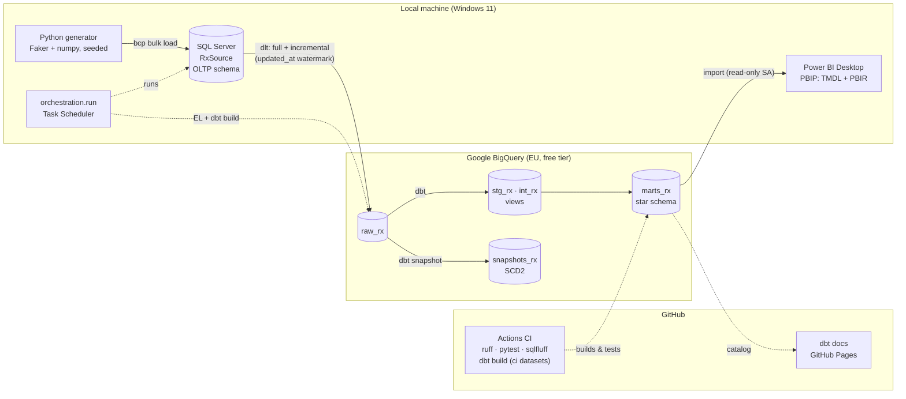

# Prescribing analytics pipeline

**SQL Server → Python (dlt) → BigQuery → dbt → Power BI**, end to end, with tests, CI and docs.

[](https://github.com/GasparPrado95/rx-analytics-pipeline/actions/workflows/ci.yml)
[](https://gasparprado95.github.io/rx-analytics-pipeline/)

> **All data in this project is synthetic.** It is modelled on the shape of the public
> [English Prescribing Dataset](https://opendata.nhsbsa.net/dataset/english-prescribing-data-epd)
> (NHS England primary care), but no row describes a real patient, prescriber or practice. NHS
> region and ICB names are real public reference data; everything else is generated.


## The problem

Primary-care prescribing is one of the NHS's largest and most scrutinised costs. Commissioners
(Integrated Care Boards) want to know:

- How much is prescribed, what it costs, and how that is changing.
- Where prescribing rates differ by region, ICB and deprivation, and by how much.
- How much could be saved by prescribing generics where a generic exists.
- Whether the numbers can be trusted: late, duplicated or corrected records are normal in
  operational data.

This project builds the whole data path to answer those questions. It starts from an
operational SQL Server database, as a dispensing system would hold it, and ends at a Power BI
dashboard, with each step tested, documented and reproducible.

## Architecture



| Stage | What it does | Details |
|---|---|---|
| **1. Source** | SQL Server `RxSource`: 14 tables, 400 practices, 50k banded patients, **2.5M prescription lines** (2023–2025) with seasonality, regional variation, a branded-to-generic shift, price changes and deliberate data-quality defects | [docs/01](docs/01-source-database.md) |
| **2. Extract & load** | dlt pipeline into BigQuery `raw_rx`: full reloads for dimensions, **incremental merge on an `updated_at` watermark** for transactions, retries, a run log | [docs/02](docs/02-extract-load.md) |
| **3. Transform** | dbt: staging → intermediate business rules → **star schema** (incremental, partitioned and clustered fact), SCD2 price snapshot, **169 tests**, freshness checks | [docs/03](docs/03-transform-dbt.md) |
| **4. Orchestrate & CI** | One-command local run with a report, Windows Task Scheduler, GitHub Actions CI on every PR, dbt docs on Pages | [docs/04](docs/04-orchestration-ci.md) |
| **5. Dashboard** | Power BI semantic model (42 measures) authored with the Power BI modelling MCP, a six-page report generated as code, an accessible plum and gold theme | [docs/05](docs/05-power-bi.md) |

## What the dashboard shows

| Executive overview | Regional variation |
|---|---|
|  |  |
| **Medicines & BNF drill-down** | **Generic vs branded savings** |
|  |  |

The **Data quality & pipeline health** page ([screenshot](docs/images/dashboard_06_quality.png))
shows what the pipeline found and fixed, and the history of every load.

Findings built into the synthetic data and recovered by the pipeline:
- About **1,500 items per 1,000 patients per month**, 45% higher in the North East and
  Yorkshire than in the South East.
- The generic prescribing rate rises from **89.5% to 93.0%**.
- About **£1.2M** of avoidable branded spend over three years.
- Antibiotics peak every winter.

## Tech choices and trade-offs

| Choice | Why | Trade-off |
|---|---|---|
| **Header/line OLTP source** in SQL Server | Makes the pipeline do real modelling work instead of copying a flat extract | More joins in dbt |
| **bcp** bulk load, indexes built after, constraints re-validated | 2.5M rows in about 2 minutes, with trusted foreign keys | Windows-specific tooling (an ODBC fallback exists) |
| **dlt** for extract & load | Schema inference, incremental state stored in BigQuery, merge SQL, resumable loads | Another framework to learn; one driver quirk (see below) |
| **`updated_at` watermark**, not dispensing date | Catches late-arriving and corrected rows; a closed range plus a lag window, made idempotent by the merge | Re-reads a small window each run |
| **BigQuery batch load jobs** (Parquet) | Loading is free; streaming inserts are billed | Minutes, not seconds, of latency |
| **dbt layers** (staging / intermediate / marts) | Staging stays 1:1 with sources, business rules sit in intermediate with explicit flags, marts are a star schema | More models to maintain |
| **Incremental MERGE** fact, partitioned by month, clustered by ICB and BNF chapter | Late arrivals land in their month and corrections update in place | The merge scans the whole target (~0.6 GB), because corrections can touch any month |
| **Reconciliation tests** (incremental fact vs full recompute) | Caught two real bugs: drift after a logic change, and an unstable duplicate key | Adds a few seconds to each build |
| **PBIP** (TMDL + PBIR) and a report **generated as code** | Diffable in Git, consistent layout, one-line design changes | The generator has to be maintained alongside Desktop |
| **Three service accounts** (pipeline, CI, read-only Power BI) | Least privilege; each key can be revoked on its own | More keys to manage |

**Cost:** about 1 GB stored in BigQuery and about 2 GB scanned per full build, well inside the
free tier (10 GB storage, 1 TB queries per month). The dbt profile caps any single query at 5 GB
billed.

## Run it from a clean machine

### Prerequisites

| Tool | Notes |
|---|---|
| Windows 11 + PowerShell | |
| SQL Server 2019+ (Developer edition is free) | Windows authentication |
| Microsoft ODBC Driver 18 + `sqlcmd` / `bcp` | [Microsoft download](https://learn.microsoft.com/sql/connect/odbc/download-odbc-driver-for-sql-server) |
| Python 3.12 | e.g. `uv python install 3.12`. dbt and dlt don't support 3.14 yet |
| Git (and optionally the GitHub CLI) | |
| A Google Cloud project with BigQuery | The free tier is enough; billing linked avoids the sandbox's 60-day table expiry |
| Power BI Desktop | For the dashboard |

**Google Cloud service accounts:** create one per role and keep each key **outside the repo**.

| Account | Roles | Used by |
|---|---|---|
| pipeline | BigQuery Data Editor, BigQuery Job User | local EL + dbt |
| CI | BigQuery Data Editor, BigQuery Job User | GitHub Actions (secret `GCP_SA_KEY`) |
| Power BI | BigQuery Data Viewer, BigQuery Job User, BigQuery Read Session User | Power BI Desktop |

### Steps

```powershell
# 1. Clone and create the environment
git clone https://github.com/GasparPrado95/rx-analytics-pipeline.git
cd rx-analytics-pipeline
uv venv .venv --python 3.12; .\.venv\Scripts\Activate.ps1
uv pip install -r requirements.txt -r requirements-dev.txt

# 2. Configure: SQL Server instance, GCP project, path to the pipeline key
Copy-Item .env.example .env; notepad .env
Copy-Item dbt_rx\profiles.yml.example $env:USERPROFILE\.dbt\profiles.yml   # no secrets in it

# 3. Build the source database (~2 minutes) and check it
python -m generator
python -m generator.check

# 4. Run the whole pipeline: EL -> dbt build -> freshness -> report in logs\
python -m orchestration.run
#    or step by step:
#    python -m el.run
#    cd dbt_rx; dotenv -f ..\.env run -- dbt deps; dotenv -f ..\.env run -- dbt build

# 5. Optional: simulate new source activity, then watch the incremental loads and the snapshot
python -m generator.simulate; python -m orchestration.run

# 6. Optional: schedule a daily run
.\scripts\register_scheduled_task.ps1

# 7. Tests
python -m pytest
```

8. **Dashboard:** open `powerbi/RxAnalytics.pbip` in Power BI Desktop, sign in with **Google
   BigQuery → Service Account Login** using the Power BI key, and refresh. The fact table takes
   about 3–4 minutes.

**CI:** add the repository secret `GCP_SA_KEY` (the CI key's JSON) and the variable
`GCP_PROJECT_ID`. Pull requests then run ruff, pytest, sqlfluff and a full `dbt build` in
throwaway `ci_pr<N>_*` datasets. Merges to `main` publish the dbt docs.

### Find your way around

```
generator/        synthetic data generator, bcp loader, integrity checks, new-batch simulator
sql_server/       DDL, integrity checks, simulation SQL
el/               dlt extract & load (config.yaml, pipeline, CLI)
dbt_rx/           dbt project: staging, intermediate, marts, snapshot, tests
orchestration/    local pipeline runner with run report
scripts/          Task Scheduler scripts, CI dataset cleanup
powerbi/          PBIP: semantic model (TMDL), report (PBIR), theme, report generator
tests/            pytest suite (67 tests)
docs/             phase-by-phase write-ups and dashboard screenshots
.github/          CI and docs workflows
```

## Lessons worth sharing

1. **The watermark column matters.** A dispensing-date watermark would silently miss the 1.5% of
   lines that arrive late and the ones corrected later. `updated_at` catches both.
2. **Test the incremental model against a full recomputation.** That test caught drift after a
   logic change, and a duplicate key built on mutable columns that only failed after a source
   correction.
3. **Check KPIs for realism, not just correctness.**
   - "Items per 1,000 patients" first came out at 0.6 per month, because it divided by the wrong
     population.
   - A year-on-year card showed +53% because `SAMEPERIODLASTYEAR` across all years compared
     2023–25 with 2023–24.
4. **Least privilege, verified.** The Power BI account was tested with an actual write attempt
   before shipping.
5. **Tooling quirks are part of the job.**
   - Power BI's BigQuery driver can't authenticate the Storage Read API with service-account
     login.
   - `lag` is not a valid DAX variable name.
   - Power BI visuals only scale K/M when the scaling commas sit before the decimal point.

## What I'd do next

- **Orchestration:** Dagster or Airflow, with asset-level lineage, sensors on the source and
  alerting, instead of a scheduled script.
- **Infrastructure as code:** Terraform for the BigQuery datasets, service accounts, IAM bindings
  and budget alerts.
- **Cloud-hosted source:** Azure SQL or Cloud SQL with private networking, so CI and orchestration
  can run the EL step end to end.
- **Slim CI:** `dbt build --select state:modified+ --defer`, against the production manifest.
- **Data contracts:** enforce model contracts on the marts, and add anomaly tests on volumes and
  costs (e.g. Elementary).
- **Semantic layer:** define the KPIs once (dbt Semantic Layer or the Power BI model as a shared
  dataset), and publish the report to the Power BI service with scheduled refresh and row-level
  security by ICB.
- **Cheaper incremental merges:** `incremental_predicates` or insert-overwrite by month, once
  late-arrival windows are bounded.

## About

Portfolio project by **Gaspar Prado**: data and BI analyst focused on healthcare.
Built with Python, SQL Server, dlt, Google BigQuery, dbt, GitHub Actions and Power BI.
