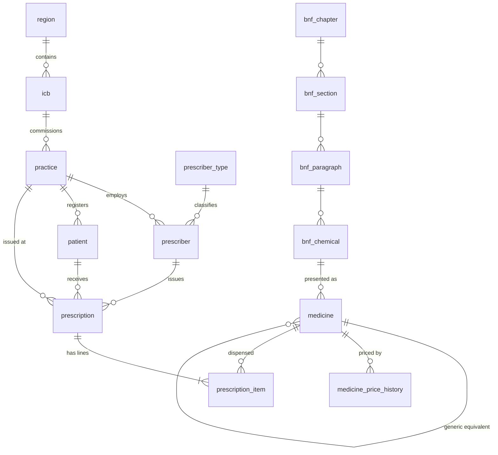
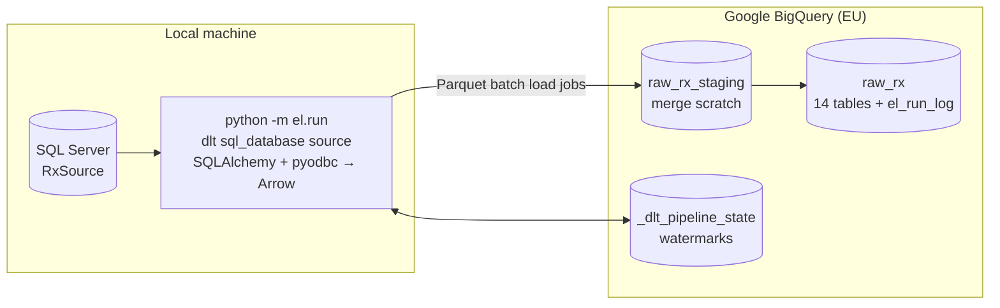
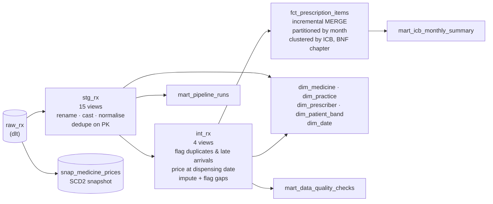
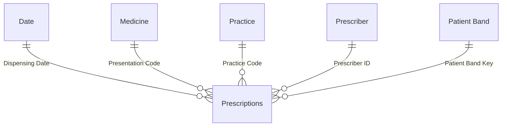

# rx-analytics-pipeline

End-to-end prescription analytics pipeline: **SQL Server → BigQuery → dbt → Power BI**.

> **All data in this project is synthetic.** It is modelled on the shape of the public
> [English Prescribing Dataset](https://opendata.nhsbsa.net/dataset/english-prescribing-data-epd),
> but no row describes a real patient, prescriber or practice. NHS region and ICB names are
> real public reference data; practice, prescriber and patient records are generated.

Full documentation lands in Phase 6. Progress so far:

| Phase | Scope | Status |
|---|---|---|
| 1 | Source database (SQL Server) + data generator | ✅ |
| 2 | Extract & load (Python → BigQuery) | ✅ |
| 3 | Transform (dbt) | ✅ |
| 4 | Orchestration & CI | ✅ |
| 5 | Power BI dashboard | ✅ |
| 6 | Documentation | ⏳ |

---

## Phase 1: Source database (`RxSource`)

### Data model

A normalised OLTP-style schema (`rx` schema): prescriptions are **headers** with **line items**,
like a dispensing system, not the flat EPD extract. Flattening happens later, in dbt.



| Table | Rows | Notes |
|---|---:|---|
| `region` / `icb` | 7 / 42 | Real NHS England regions and Integrated Care Boards |
| `practice` | 400 | ODS-style codes, postcode district, list size, rural/urban, deprivation decile |
| `prescriber` | 1,500 | GPs, nurse and pharmacist prescribers (Faker names) |
| `bnf_*` | 13 / 53 / 78 / 159 | BNF chapter → section → paragraph → chemical substance |
| `medicine` | 570 | Presentations: generic and branded, generic-equivalent link, unit cost |
| `medicine_price_history` | 1,230 | Drug Tariff-style price changes, one open row per medicine |
| `patient` | 50,000 | Age band, sex, deprivation decile only: **no PII** |
| `prescription` | ~1.72M | Header: patient, prescriber, practice, issue date |
| `prescription_item` | ~2.50M | Line: medicine, items, quantity, NIC, actual cost, dispensing date |

### Patterns built into the data

| Pattern | How it shows up |
|---|---|
| Seasonality | Antibiotics peak in winter (Dec ≈ 1.3× the average month), flu antivirals spike sharply, antihistamines and nasal steroids peak in May–July, nicotine replacement peaks in January |
| Branded → generic shift | Branded share falls ~45% over 36 months where a generic exists. Sitagliptin goes 85% → 15% after its generic launch |
| Regional variation | Items per head: North East & Yorkshire ≈ 1.5× London. Antibiotic habits vary by region. Deprived practices prescribe more |
| Growth and decline | DOACs, SGLT2 inhibitors, ADHD drugs and HRT grow. Warfarin, diclofenac and atenolol decline |
| Price events | Price concessions (amoxicillin in winter 2022/23, sertraline, amlodipine, co-codamol, levothyroxine), tariff reductions (pregabalin, sitagliptin, tadalafil), annual uplifts on branded prices |
| Patient mix | Medicines go to plausible patients: contraceptives to women aged 15–44, tamsulosin to older men, paediatric liquids to children |

### Deliberate data-quality issues (for the dbt layer to handle)

| Issue | Approx. volume |
|---|---:|
| Duplicate item lines (double submission, new id, same content) | ~5,000 |
| Late-arriving lines (reach the source 35–150 days after dispensing) | ~37,600 |
| Restated lines (quantity/cost corrected later, `updated_at` bumped) | ~7,400 |
| NULL `actual_cost` / `quantity` / `net_ingredient_cost` | ~7,400 / ~1,300 / ~1,200 |
| Credit lines (negative quantity and cost) | ~500 |
| Patients with NULL deprivation decile / non-standard sex codes | ~480 / ~390 |
| Practices with NULL postcode / inconsistent `rural_urban` casing | 3 / ~20 |

Late arrivals and restatements are why the extract (Phase 2) uses an **`updated_at`
high-watermark** rather than dispensing date: a dispensing-date watermark would silently miss them.

### Setup (Windows 11, PowerShell)

**1. Check your SQL Server instance name and authentication mode**

```powershell
# MSSQLSERVER = default instance (connect as "localhost").
# MSSQL$<NAME> = named instance (connect as "localhost\<NAME>").
Get-Service -Name 'MSSQL*' | Select-Object Name, Status

# IsIntegratedSecurityOnly: 1 = Windows authentication only, 0 = mixed mode.
sqlcmd -S localhost -E -C -Q "SELECT @@SERVERNAME AS server, SERVERPROPERTY('InstanceName') AS instance, SERVERPROPERTY('IsIntegratedSecurityOnly') AS windows_auth_only"

# ODBC Driver 18 must be listed
Get-OdbcDriver -Platform 64-bit | Where-Object Name -like '*SQL Server*' | Select-Object Name
```

The project uses Windows authentication (`Trusted_Connection=yes`), so no database password exists anywhere.

**2. Python environment** (Python 3.12. dbt and dlt in later phases don't support 3.14 yet.)

```powershell
uv python install 3.12            # or install Python 3.12 from python.org
uv venv .venv --python 3.12
.\.venv\Scripts\Activate.ps1
uv pip install -r requirements.txt   # or: pip install -r requirements.txt
Copy-Item .env.example .env          # edit SQL_SERVER if you use a named instance
```

**3. Generate and load** (drops and recreates `RxSource`, ~2 minutes)

```powershell
python -m generator                  # full volume: ~2.5M lines
python -m generator --lines 100000   # quick small run
python -m generator --loader odbc    # without the bcp utility (slower)
python -m generator.check            # row counts, referential integrity, DQ profile
```

The DDL scripts in [`sql_server/ddl`](sql_server/ddl) can also be run by hand:
`sqlcmd -S localhost -E -C -b -i sql_server\ddl\00_create_database.sql` (then `01_`, `02_`).

### Design decisions

- **Header/line OLTP model, not a flat extract.** It makes the pipeline do real work. The dbt
  intermediate layer joins line → header → practice → ICB → region, as you would against a real
  dispensing system.
- **`created_at` / `updated_at` on every table.** They give the extract layer a reliable change
  marker. Item ids are assigned in arrival order (like an `IDENTITY`), so late arrivals get high
  ids even though their dispensing dates are old.
- **Reproducible.** One seeded `numpy` Generator plus a seeded Faker. Faker is pinned because its
  output changes between versions. Two runs with the same seed produce identical tables.
- **Vectorised and calibrated generation.** Prescriptions per practice per month are drawn as
  Poisson(list size × regional rate × deprivation × seasonal medicine demand × trend). The rate is
  solved so the total hits the target line count. Generating 2.5M lines takes about 4 seconds.
- **Bulk load, then index, then trust.** `bcp` in character mode with `TABLOCK` into tables that
  only have clustered primary keys. Under the SIMPLE recovery model that load is minimally logged.
  Secondary indexes are built afterwards, which is faster than maintaining them row by row.
  `bcp` skips foreign-key checks, so every table is re-validated with
  `WITH CHECK CHECK CONSTRAINT ALL`: constraints end **trusted**, which the optimizer relies on
  and the check script verifies. `pyodbc` `fast_executemany` (array binding) is the fallback.
- **Synthetic but EPD-shaped codes.** BNF chemical (9-char) and presentation (15-char) codes follow
  the EPD format but are generated. They do not map to real BNF codes, and costs are illustrative,
  not Drug Tariff prices.

---

## Phase 2: Extract & load (`el/`)

A [dlt](https://dlthub.com) pipeline copies `RxSource` into the BigQuery dataset `raw_rx`
unchanged (no renames, no business logic). Transformations belong to dbt in Phase 3.



### Run it

```powershell
# one-time: fill GCP_PROJECT_ID and GOOGLE_APPLICATION_CREDENTIALS in .env (key file OUTSIDE the repo)
python -m el.run                          # incremental: dimensions reloaded, transactions merged
python -m el.run --full-refresh           # drop raw tables + watermarks, reload everything
python -m el.run --tables medicine,prescription_item
python -m generator.simulate              # write a "new batch" into the source to see incrementals work
python -m pytest                          # unit tests
```

Each run logs to the console and to `logs/el_<timestamp>.log`, and appends one row per table
to `raw_rx.el_run_log`: rows loaded, watermark before and after, status and error. The
pipeline-health dashboard page in Phase 5 reads from it.

### Load strategy (`el/config.yaml`)

| Tables | Mode | dlt write disposition | Why |
|---|---|---|---|
| region, icb, practice, prescriber(_type), bnf_*, medicine, medicine_price_history, patient | `full` | `replace` | Small (≤ 50k rows). A full reload is simpler than tracking changes and stays cheap |
| prescription, prescription_item | `incremental` on `updated_at` | `merge` on primary key | 1.7M / 2.5M rows. Only changed rows move |

**Why `updated_at` and not `dispensing_date`.** About 1.5% of lines arrive weeks or months after
they were dispensed, and some are corrected later. A watermark on dispensing date would miss
both. `updated_at` catches new, late and restated rows, and the merge on `item_line_id`
overwrites restatements in place.

**Boundary handling.** A source batch commits many rows with the same `updated_at`. The filter
is `>= watermark` (closed range) with a 5-minute lag window, so rows at the boundary and
transactions that commit late with older timestamps are re-read. Because the destination
**merges on the primary key**, re-reading them is idempotent. This replaces dlt's default
boundary dedup, which stores a hash of every boundary row in pipeline state; that state grows
with batch size, and dlt warned about it at 2,520 rows.

**Watermarks live with the data.** dlt stores pipeline state in BigQuery
(`_dlt_pipeline_state`) as well as locally. A fresh machine or CI runner resumes from the right
point instead of reloading everything.

### Verified behaviour

| Scenario | Result |
|---|---|
| Initial load | 14 tables, 4.3M rows in ~2.5 min |
| Re-run with no source changes | 0 new transaction rows (only the small lag window is re-read) |
| After `generator.simulate` (2,000 late lines, 500 restatements, 20 duplicates, 3 price changes) | exactly 2,520 lines picked up |
| Reconciliation BigQuery vs SQL Server | row counts, distinct keys, sums of cost and quantity, NULL counts and max timestamps all match |
| Source unreachable | classified transient, retried with backoff, exit code 1, `failed` row in `el_run_log` |

### Costs (BigQuery free tier)

- **Storage:** `raw_rx` is ~380 MB, against 10 GB of free storage per month.
- **Loading:** dlt writes Parquet and uses **batch load jobs, which are free**. Streaming inserts
  would be billed per GB.
- **Queries:** the merge statements scan the target's key columns and the staging table: tens
  of MB per incremental run, and ~0.4 GB for a full refresh. The free tier allows 1 TB of
  queries per month.
- **Least privilege:** the service account has only *BigQuery Data Editor* and *BigQuery Job
  User*.

### Design decisions

- **dlt rather than hand-written pandas.** It handles schema inference (exact `NUMERIC`
  decimals, `DATE`, `TIMESTAMP`), incremental state, merge SQL, retries of load jobs and
  resumable load packages. It works on Windows with the ODBC driver, so the SQLAlchemy +
  pandas fallback wasn't needed.
- **`pyarrow` backend.** Rows go SQL Server → Arrow → Parquet without per-row Python objects,
  so decimals stay exact.
- **Config-driven.** Adding a table is one line of YAML. The config is validated up front:
  unknown modes, incremental tables without a cursor, and duplicate names all fail before
  anything connects.
- **Retries only for transient errors.** Connection drops, timeouts and 5xx/429 responses
  (found by walking the exception chain) are retried with exponential backoff. Bugs fail fast.
- **Trade-off: raw tables aren't partitioned.** At ~380 MB, partitioning `raw_rx` would add
  complexity for little saving. The partitioned, clustered fact table is built in dbt
  (Phase 3), where queries actually run.

---

## Phase 3: Transform (`dbt_rx/`)

dbt Core 1.12 with the BigQuery adapter turns `raw_rx` into a **star schema** for Power BI.



| Layer | BigQuery dataset | Materialisation |
|---|---|---|
| staging | `stg_rx` | views, 1:1 with sources |
| intermediate | `int_rx` | views |
| marts | `marts_rx` | tables (fact is incremental) |
| snapshots | `snapshots_rx` | dbt snapshot |

A `generate_schema_name` override writes to exactly these datasets in the `prod` target. Any
other target (CI) gets prefixed datasets, such as `ci_rx_marts_rx`, so CI never touches prod.

### Run it

```powershell
# one-time: copy dbt_rx\profiles.yml.example to %USERPROFILE%\.dbt\profiles.yml (it holds no secrets)
cd dbt_rx
dotenv -f ..\.env run -- dbt deps
dotenv -f ..\.env run -- dbt build              # models + snapshot + 169 tests, in DAG order
dotenv -f ..\.env run -- dbt source freshness
dotenv -f ..\.env run -- dbt docs generate      # then: dbt docs serve
# after changing business logic in the fact's upstream models:
dotenv -f ..\.env run -- dbt build --select fct_prescription_items+ --full-refresh
```

`dotenv run` loads the repo's `.env`, so dbt's `env_var()` sees the project ID and key path.

### Star schema

| Model | Grain | Notes |
|---|---|---|
| `fct_prescription_items` | dispensed line (2.5M) | Incremental `merge` on `item_line_id`. Partitioned by `dispensing_date` (month), clustered by `icb_code`, `bnf_chapter_code` |
| `dim_medicine` | presentation (570) | Full BNF hierarchy, generic/branded, generic equivalent |
| `dim_practice` | practice (400) | Region → ICB → practice, postcode for maps, deprivation quintile |
| `dim_prescriber` | prescriber (1,500) | Profession |
| `dim_patient_band` | age band × sex × deprivation (~240) | **No patient-level key in the marts** (privacy by design) |
| `dim_date` | day, 2022–2026 | NHS financial year (Apr–Mar), season |
| `mart_icb_monthly_summary` | ICB × month | Items per 1,000 patients, cost per item, generic prescribing rate, antibacterial rate, potential generic saving |
| `mart_data_quality_checks` | check (12) | Rows affected by each defect and how it is handled |
| `mart_pipeline_runs` | EL run × table | For the pipeline-health page |
| `snap_medicine_prices` | price version | SCD2 history captured by dbt from the current-price-only `medicine` table |

### Tests (169 data tests and checks in `dbt build`)

- **Generic tests:** `unique`, `not_null`, `relationships` (every fact foreign key to its
  dimension), `accepted_values`.
- **Package tests:** `dbt_utils` (`unique_combination_of_columns`, `expression_is_true`) and
  `dbt_expectations` (value ranges, regex on BNF codes, row counts).
- **Custom generic test:** `not_in_future` for watermark and date columns.
- **Singular tests:**
  - the incremental fact reconciles with a full recomputation (lines, items, cost);
  - the ICB summary adds back up to the fact;
  - the fact contains no double submissions;
  - price history is contiguous;
  - no line is dispensed before it is issued.
- **Source freshness:** source activity is checked on `prescription_item.updated_at`, and
  pipeline activity separately on `el_run_log.finished_at`.

### Verified end to end

`generator.simulate` → `el.run` → `dbt build`:
- the fact MERGEd only the ~5k changed lines;
- the snapshot closed 3 old price versions and opened 3 new ones;
- all 169 tests pass, including the reconciliation of the incremental fact against a full
  recomputation.

### What the tests caught (and the fixes)

1. **Incremental drift after a logic change.** After I changed an imputation rule, the
   reconciliation test failed: the incremental fact only reprocesses rows whose `updated_at`
   moves, so old rows kept the old logic. **Rule:** logic changes upstream of an incremental
   model need `--full-refresh`. The test makes forgetting that impossible to miss.
2. **An unstable duplicate key.** Double submissions were first detected on (prescription,
   medicine, date, items, quantity, cost). When a source correction changed the *original*
   line's quantity, its old duplicate stopped matching and would have counted as real in a
   full rebuild but not in the incremental fact. The key is now (prescription, medicine,
   dispensing date), which corrections cannot change. Dedup rules on mutable attributes and
   incremental models don't mix.
3. **A NULL boolean.** `is_credit` was NULL when both quantity and cost were missing, and
   Power BI would have silently treated it as neither true nor false. Every flag now has a
   `not_null` test.

A fourth issue came from analysis rather than tests. Items per 1,000 patients first came out at
**0.6 per month**, where real England figures are roughly 1,600. The generator simulates
prescribing for a 50,000-patient panel, while `list_size` is each practice's full registered
list (3.7M). Rates now use the panel (`registered_patients`), giving 1,270–1,840 items per
1,000 patients per month by region.

### Costs

| | Size / scan |
|---|---|
| Storage across all datasets | ~1.0 GB (raw 0.38 + marts 0.60). Free tier: 10 GB |
| Full `dbt build` | ~2 GB scanned |
| Incremental fact MERGE | ~0.6 GB (the target table is scanned because late arrivals and corrections can touch any month) |
| Guardrail | `maximum_bytes_billed: 5 GB` per query in the profile |

A daily run comes to roughly 60 GB of queries a month, against a 1 TB free tier.

### Design decisions

- **Staging stays dumb, intermediate holds the rules.** Staging only renames, casts,
  normalises codes and dedupes on the primary key. Double-submission detection, imputation and
  credit handling are in `int_*` with explicit flags, so every rule is visible and countable in
  the DQ mart.
- **Flag, don't silently fix.** Imputed costs carry `is_nic_imputed` /
  `is_actual_cost_imputed`. Duplicates are removed from the fact but counted.
- **Price at the dispensing date.** A range join to the price history gives the tariff price
  in force when each line was dispensed. The potential generic saving uses brand and generic
  prices from the same date.
- **Fact partitioning and clustering.** Partitioning by month matches the dashboard's time
  slicing, and clustering on ICB and BNF chapter matches its most common filters. The MERGE
  still scans the whole target, a known trade-off when corrections can touch any month.
- **Docs travel with the data.** `persist_docs` writes model and column descriptions into
  BigQuery, so Power BI shows them too.
- **Snapshot vs source history.** The source keeps its own `medicine_price_history`. The dbt
  snapshot shows how to build that SCD2 history when a source only stores the current value.

---

## Phase 4: Orchestration & CI

### Local orchestration (`orchestration/`, `scripts/`)

One entry point runs the whole pipeline and reports on it:

```powershell
python -m orchestration.run                 # EL -> dbt build -> dbt source freshness -> report
python -m orchestration.run --simulate      # write a new source batch first (demo)
python -m orchestration.run --full-refresh  # rebuild raw tables and the incremental fact
.\scripts\run_pipeline.ps1                  # the same, via the venv (what Task Scheduler calls)
```

- **Isolated steps:** each step runs as a subprocess, so one step's logging or crash cannot
  corrupt another. dbt does not run on top of a failed load.
- **Report from machine-readable files:** the EL `--summary-json`, plus dbt's
  `run_results.json` and `sources.json`. No console scraping.
- **Report location:** each run writes `logs/pipeline_<timestamp>/report.md` and `report.json`,
  plus the full `pipeline.log`.
- **Exit code:** 0 on success, 1 if any step failed. Task Scheduler shows it as *Last Run Result*.

Example report:

| Step | Status | Duration | Details |
|---|---|---:|---|
| extract & load (dlt) | success | 71s | rows_loaded=56599, incremental_rows={'prescription': 12, 'prescription_item': 2520} |
| dbt build | success | 142s | counts={'success': 29, 'pass': 140} |
| dbt source freshness | success | 12s | counts={'pass': 2} |

#### Scheduling with Windows Task Scheduler

```powershell
.\scripts\register_scheduled_task.ps1              # daily at 06:00 as the current user
.\scripts\register_scheduled_task.ps1 -At '07:30'
Start-ScheduledTask -TaskName 'rx-analytics-pipeline'                   # run now
(Get-ScheduledTaskInfo -TaskName 'rx-analytics-pipeline').LastTaskResult # 0 = success
Unregister-ScheduledTask -TaskName 'rx-analytics-pipeline' -Confirm:$false
```

The task runs as your user, only while you're logged on. That's what Windows authentication to
SQL Server needs, and it means no password is stored. It catches up after missed runs, retries
twice at 15-minute intervals, and never overlaps itself.

To do it by hand in the Task Scheduler UI instead:
1. *Create Task*.
2. Set *Run only when user is logged on*.
3. Add a *Daily* trigger.
4. Add an action: program `powershell.exe`, arguments
   `-NoProfile -ExecutionPolicy Bypass -File "<repo>\scripts\run_pipeline.ps1"`, start in `<repo>`.

### GitHub Actions

| Workflow | Trigger | What it does |
|---|---|---|
| [`ci.yml`](.github/workflows/ci.yml) | pull request to `main` | **Python job:** `ruff`, `pytest`. **dbt job:** `sqlfluff` (dbt templater, BigQuery dialect), `dbt build --target ci` into isolated `ci_pr<N>_*` datasets, source freshness (informational), artifacts uploaded, CI datasets dropped (`if: always()`) |
| [`docs.yml`](.github/workflows/docs.yml) | push to `main` | `dbt docs generate --static` → GitHub Pages: **https://gasparprado95.github.io/rx-analytics-pipeline/** |

**Repository settings used by the workflows:**

| Name | Kind | Value |
|---|---|---|
| `GCP_SA_KEY` | **secret** | Full JSON key of the CI service account (`rx-ci`, roles BigQuery Data Editor + BigQuery Job User) |
| `GCP_PROJECT_ID` | variable | `rx-analytics-pipeline` |

To set the secret from PowerShell:
`Get-Content "<path-to-ci-key>.json" -Raw | gh secret set GCP_SA_KEY --repo GasparPrado95/rx-analytics-pipeline`.
Or in the UI: *Settings → Secrets and variables → Actions → New repository secret*.

**Why a separate CI service account?** A leaked CI key can be revoked without breaking the local
pipeline, and BigQuery audit logs show which jobs came from CI.

### Trade-off: CI cannot reach the local SQL Server

GitHub-hosted runners cannot connect to a SQL Server on a home machine, and opening it to the
internet would be the wrong fix. So:

- **CI covers dbt and Python.** dbt builds every model, the snapshot and all 169 tests from the
  production `raw_rx` dataset (read-only), into throwaway `ci_pr<N>_*` datasets. Python logic
  is covered by unit tests.
- **The EL step is verified locally**, by the orchestrator and the reconciliation checks in
  Phase 2. It's not end-to-end in CI.
- **Ways to close the gap:**
  - a self-hosted runner on the same machine;
  - a cloud-hosted source (e.g. Azure SQL or Cloud SQL) with private networking;
  - a containerised SQL Server in CI, seeded by the generator at a small `--lines` value.

Each CI run scans ~2 GB and briefly stores ~0.6 GB, well within the free tier. Slim CI
(`dbt build --select state:modified+ --defer`) would cut that further as the project grows.

### Lint configuration

- **ruff:** `pyproject.toml`.
- **sqlfluff:** `dbt_rx/.sqlfluff`. BigQuery dialect, dbt templater, lower-case keywords,
  explicit aliases, 120-character lines. Three rules are excluded, each with a reason in the file.

---

## Phase 5: Power BI dashboard (`powerbi/`)

An import-mode Power BI report over the dbt marts, saved as **PBIP**: a TMDL semantic model plus a
PBIR report, both plain text, so every change is diffable in Git.


| Executive overview | Regional variation |
|---|---|
|  |  |
| **Medicines & BNF drill-down** | **Generic vs branded savings** |
|  |  |
| **Data quality & pipeline health** | |
|  | |

### Semantic model (`RxAnalytics.SemanticModel`)

Authored with the **Power BI modelling MCP server** (tables, relationships, hierarchies,
measures), exported to TMDL, then loaded and validated in Power BI Desktop.



- **Star schema:** single-direction one-to-many relationships, a marked Date table (2023–2025
  only, so "months in period" and time intelligence stay exact), and auto date/time switched off.
- **Two hierarchies:** BNF (chapter > section > paragraph > chemical > presentation) and
  Organisation (region > ICB > practice).
- **Two pipeline-health tables** with no relationships: Data Quality Checks and Pipeline Runs.
- **42 measures** in display folders, all with descriptions:

| Folder | Measures |
|---|---|
| Volume | Total Items, Prescription Lines, Total Quantity |
| Cost | Total Cost (net ingredient cost), Actual Cost, Cost per Item |
| Rates | Items per 1,000 Patients, Cost per 1,000 Patients, Antibacterial Items per 1,000 Patients (monthly averages) |
| Generic & Savings | Generic %, Generic/Branded Items Where Generic Available, Potential Generic Saving, Saving % of Branded Cost |
| Time Intelligence | Items / Cost YoY %, Generic % Change vs PY, Total Items / Cost PY, Items / Cost / Generic % Rolling 12M |
| Data Quality / Pipeline | Late Arrival %, Imputed Cost Lines, Duplicates Removed, Last EL Run, Hours Since Last EL Run, EL Success Rate |

**Validated against BigQuery:** lines, items, total cost (£20,412,879.81), generic rate, potential
saving, rates per 1,000, YoY and rolling 12-month values match direct SQL on the marts exactly.

### Report (`RxAnalytics.Report`, generated by `powerbi/_build/build_report.py`)

Six pages: a linked cover, then *Executive overview*, *Regional variation*, *Medicines & BNF
drill-down*, *Generic vs branded* and *Data quality & pipeline health*. Every page has the same
header navigation. The report is generated by code, which keeps layout, titles and formatting
consistent and lets a design change be one edit and a rebuild.

**Theme** ([`powerbi/theme/rx-plum-gold.json`](powerbi/theme/rx-plum-gold.json)):
- **Data colours:** plum `#6A3B98`, gold `#B57D00`, lavender `#A07AD6` and bronze `#8A5A12` on a
  warm ivory canvas. They're used in fixed order, single-series charts are plum, and gold marks
  cost and savings.
- **Decoration:** a deep aubergine header with a thin gold rule, Georgia titles and Segoe UI text.
  These colours are never used for data.
- **Accessibility:** the data colours were **validated, not eyeballed**. A palette checker
  confirmed each sits in a readable lightness band and has enough chroma, adjacent colours stay
  distinguishable under simulated colour blindness (worst ΔE 24), and each reaches at least 3:1
  contrast on both the ivory canvas and white cards.

**Cover photo:** 1860s apothecary bottles, Sherbrooke Village Museum, by France3470, **public
domain** (Wikimedia Commons). It's graded to the plum and gold palette by
[`make_cover.py`](powerbi/_build/make_cover.py).

### Open and refresh

1. Open `powerbi/RxAnalytics.pbip` in Power BI Desktop.
2. On the first refresh, choose **Google BigQuery → Service Account Login** and paste the
   read-only key's email and JSON. The `GCP Project` parameter sets the billing project.
3. Refresh. The 2.5M-row fact table loads in about 3–4 minutes.

To change the report layout, edit `build_report.py`, **close Desktop**, then run
`python powerbi/_build/build_report.py`. An open Desktop would overwrite the files on save.

### Design decisions and lessons

- **Read-only access:** a dedicated `rx-power-bi` service account with **BigQuery Data Viewer +
  Job User + Read Session User**. A test write was refused (403) before shipping.
- **Storage Read API off for the fact table:** Power BI's BigQuery driver failed to authenticate
  the Storage Read API with service-account login. The same key works from Python, and only
  large results use that API, so the fact query sets `UseStorageApi = false`; the small tables
  are unaffected.
- **Fix queries in the files, not in Desktop's model:** Power Query keeps its own copy of each
  query, so "Apply changes" overwrote a fix made only in the data model.
- **Year-on-year compares the latest year with the one before.** A `SAMEPERIODLASTYEAR` card
  across all years compared 2023–25 with 2023–24 and showed **+53%** instead of +5.2%.
- **Rates use the simulated patient panel** (50,000 patients), not practice list sizes (3.7M).
  Otherwise "items per 1,000 patients" would be 0.6 instead of a realistic ~1,500 a month.
- **Format strings:** visuals only scale K/M when the scaling commas sit before the decimal
  point (`£#,0,,.0"M"`). `£#,0.0,,"M"` renders a stray comma.
- **`lag` is not a valid DAX variable name.** One failing calculated column fails the whole
  refresh.
- **No map visual:** maps are disabled by default in Desktop's security settings, so an
  ICB bar chart replaces it.
