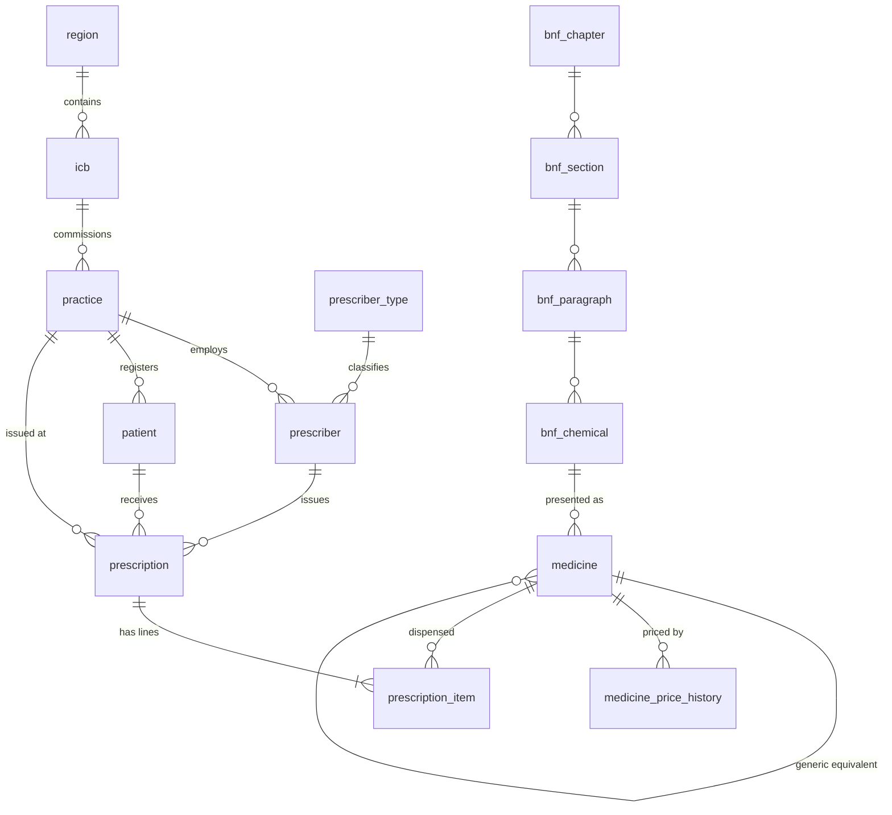

[← Back to README](../README.md)

# Phase 1: Source database (`RxSource`)

### Data model

A normalised OLTP-style schema (`rx` schema): prescriptions are **headers** with **line items**,
like a dispensing system, not the flat EPD extract. Flattening happens later, in dbt.



| Table | Rows | Notes |
|---|---:|---|
| `region` / `icb` | 7 / 42 | Real NHS England regions and Integrated Care Boards |
| `practice` | 400 | ODS-style codes, postcode district, list size, rural/urban, deprivation decile |
| `prescriber` | 1,500 | GPs, nurse and pharmacist prescribers (Faker names) |
| `bnf_*` | 13 / 53 / 78 / 159 | BNF chapter → section → paragraph → chemical substance |
| `medicine` | 570 | Presentations: generic and branded, generic-equivalent link, unit cost |
| `medicine_price_history` | 1,230 | Drug Tariff-style price changes, one open row per medicine |
| `patient` | 50,000 | Age band, sex, deprivation decile only: **no PII** |
| `prescription` | ~1.72M | Header: patient, prescriber, practice, issue date |
| `prescription_item` | ~2.50M | Line: medicine, items, quantity, NIC, actual cost, dispensing date |

### Patterns built into the data

| Pattern | How it shows up |
|---|---|
| Seasonality | Antibiotics peak in winter (Dec ≈ 1.3× the average month), flu antivirals spike sharply, antihistamines and nasal steroids peak in May–July, nicotine replacement peaks in January |
| Branded → generic shift | Branded share falls ~45% over 36 months where a generic exists. Sitagliptin goes 85% → 15% after its generic launch |
| Regional variation | Items per head: North East & Yorkshire ≈ 1.5× London. Antibiotic habits vary by region. Deprived practices prescribe more |
| Growth and decline | DOACs, SGLT2 inhibitors, ADHD drugs and HRT grow. Warfarin, diclofenac and atenolol decline |
| Price events | Price concessions (amoxicillin in winter 2022/23, sertraline, amlodipine, co-codamol, levothyroxine), tariff reductions (pregabalin, sitagliptin, tadalafil), annual uplifts on branded prices |
| Patient mix | Medicines go to plausible patients: contraceptives to women aged 15–44, tamsulosin to older men, paediatric liquids to children |

### Deliberate data-quality issues (for the dbt layer to handle)

| Issue | Approx. volume |
|---|---:|
| Duplicate item lines (double submission, new id, same content) | ~5,000 |
| Late-arriving lines (reach the source 35–150 days after dispensing) | ~37,600 |
| Restated lines (quantity/cost corrected later, `updated_at` bumped) | ~7,400 |
| NULL `actual_cost` / `quantity` / `net_ingredient_cost` | ~7,400 / ~1,300 / ~1,200 |
| Credit lines (negative quantity and cost) | ~500 |
| Patients with NULL deprivation decile / non-standard sex codes | ~480 / ~390 |
| Practices with NULL postcode / inconsistent `rural_urban` casing | 3 / ~20 |

Late arrivals and restatements are why the extract (Phase 2) uses an **`updated_at`
high-watermark** rather than dispensing date: a dispensing-date watermark would silently miss them.

### Setup (Windows 11, PowerShell)

**1. Check your SQL Server instance name and authentication mode**

```powershell
# MSSQLSERVER = default instance (connect as "localhost").
# MSSQL$<NAME> = named instance (connect as "localhost\<NAME>").
Get-Service -Name 'MSSQL*' | Select-Object Name, Status

# IsIntegratedSecurityOnly: 1 = Windows authentication only, 0 = mixed mode.
sqlcmd -S localhost -E -C -Q "SELECT @@SERVERNAME AS server, SERVERPROPERTY('InstanceName') AS instance, SERVERPROPERTY('IsIntegratedSecurityOnly') AS windows_auth_only"

# ODBC Driver 18 must be listed
Get-OdbcDriver -Platform 64-bit | Where-Object Name -like '*SQL Server*' | Select-Object Name
```

The project uses Windows authentication (`Trusted_Connection=yes`), so no database password exists anywhere.

**2. Python environment** (Python 3.12. dbt and dlt in later phases don't support 3.14 yet.)

```powershell
uv python install 3.12            # or install Python 3.12 from python.org
uv venv .venv --python 3.12
.\.venv\Scripts\Activate.ps1
uv pip install -r requirements.txt   # or: pip install -r requirements.txt
Copy-Item .env.example .env          # edit SQL_SERVER if you use a named instance
```

**3. Generate and load** (drops and recreates `RxSource`, ~2 minutes)

```powershell
python -m generator                  # full volume: ~2.5M lines
python -m generator --lines 100000   # quick small run
python -m generator --loader odbc    # without the bcp utility (slower)
python -m generator.check            # row counts, referential integrity, DQ profile
```

The DDL scripts in [`sql_server/ddl`](../sql_server/ddl) can also be run by hand:
`sqlcmd -S localhost -E -C -b -i sql_server\ddl\00_create_database.sql` (then `01_`, `02_`).

### Design decisions

- **Header/line OLTP model, not a flat extract.** It makes the pipeline do real work. The dbt
  intermediate layer joins line → header → practice → ICB → region, as you would against a real
  dispensing system.
- **`created_at` / `updated_at` on every table.** They give the extract layer a reliable change
  marker. Item ids are assigned in arrival order (like an `IDENTITY`), so late arrivals get high
  ids even though their dispensing dates are old.
- **Reproducible.** One seeded `numpy` Generator plus a seeded Faker. Faker is pinned because its
  output changes between versions. Two runs with the same seed produce identical tables.
- **Vectorised and calibrated generation.** Prescriptions per practice per month are drawn as
  Poisson(list size × regional rate × deprivation × seasonal medicine demand × trend). The rate is
  solved so the total hits the target line count. Generating 2.5M lines takes about 4 seconds.
- **Bulk load, then index, then trust.** `bcp` in character mode with `TABLOCK` into tables that
  only have clustered primary keys. Under the SIMPLE recovery model that load is minimally logged.
  Secondary indexes are built afterwards, which is faster than maintaining them row by row.
  `bcp` skips foreign-key checks, so every table is re-validated with
  `WITH CHECK CHECK CONSTRAINT ALL`: constraints end **trusted**, which the optimizer relies on
  and the check script verifies. `pyodbc` `fast_executemany` (array binding) is the fallback.
- **Synthetic but EPD-shaped codes.** BNF chemical (9-char) and presentation (15-char) codes follow
  the EPD format but are generated. They do not map to real BNF codes, and costs are illustrative,
  not Drug Tariff prices.
