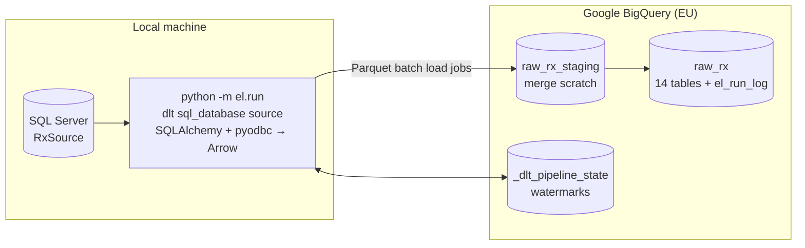

[← Back to README](../README.md)

# Phase 2: Extract & load (`el/`)

A [dlt](https://dlthub.com) pipeline copies `RxSource` into the BigQuery dataset `raw_rx`
unchanged (no renames, no business logic). Transformations belong to dbt in Phase 3.



### Run it

```powershell
# one-time: fill GCP_PROJECT_ID and GOOGLE_APPLICATION_CREDENTIALS in .env (key file OUTSIDE the repo)
python -m el.run                          # incremental: dimensions reloaded, transactions merged
python -m el.run --full-refresh           # drop raw tables + watermarks, reload everything
python -m el.run --tables medicine,prescription_item
python -m generator.simulate              # write a "new batch" into the source to see incrementals work
python -m pytest                          # unit tests
```

Each run logs to the console and to `logs/el_<timestamp>.log`, and appends one row per table
to `raw_rx.el_run_log`: rows loaded, watermark before and after, status and error. The
pipeline-health dashboard page in Phase 5 reads from it.

### Load strategy (`el/config.yaml`)

| Tables | Mode | dlt write disposition | Why |
|---|---|---|---|
| region, icb, practice, prescriber(_type), bnf_*, medicine, medicine_price_history, patient | `full` | `replace` | Small (≤ 50k rows). A full reload is simpler than tracking changes and stays cheap |
| prescription, prescription_item | `incremental` on `updated_at` | `merge` on primary key | 1.7M / 2.5M rows. Only changed rows move |

**Why `updated_at` and not `dispensing_date`.** About 1.5% of lines arrive weeks or months after
they were dispensed, and some are corrected later. A watermark on dispensing date would miss
both. `updated_at` catches new, late and restated rows, and the merge on `item_line_id`
overwrites restatements in place.

**Boundary handling.** A source batch commits many rows with the same `updated_at`. The filter
is `>= watermark` (closed range) with a 5-minute lag window, so rows at the boundary and
transactions that commit late with older timestamps are re-read. Because the destination
**merges on the primary key**, re-reading them is idempotent. This replaces dlt's default
boundary dedup, which stores a hash of every boundary row in pipeline state; that state grows
with batch size, and dlt warned about it at 2,520 rows.

**Watermarks live with the data.** dlt stores pipeline state in BigQuery
(`_dlt_pipeline_state`) as well as locally. A fresh machine or CI runner resumes from the right
point instead of reloading everything.

### Verified behaviour

| Scenario | Result |
|---|---|
| Initial load | 14 tables, 4.3M rows in ~2.5 min |
| Re-run with no source changes | 0 new transaction rows (only the small lag window is re-read) |
| After `generator.simulate` (2,000 late lines, 500 restatements, 20 duplicates, 3 price changes) | exactly 2,520 lines picked up |
| Reconciliation BigQuery vs SQL Server | row counts, distinct keys, sums of cost and quantity, NULL counts and max timestamps all match |
| Source unreachable | classified transient, retried with backoff, exit code 1, `failed` row in `el_run_log` |

### Costs (BigQuery free tier)

- **Storage:** `raw_rx` is ~380 MB, against 10 GB of free storage per month.
- **Loading:** dlt writes Parquet and uses **batch load jobs, which are free**. Streaming inserts
  would be billed per GB.
- **Queries:** the merge statements scan the target's key columns and the staging table: tens
  of MB per incremental run, and ~0.4 GB for a full refresh. The free tier allows 1 TB of
  queries per month.
- **Least privilege:** the service account has only *BigQuery Data Editor* and *BigQuery Job
  User*.

### Design decisions

- **dlt rather than hand-written pandas.** It handles schema inference (exact `NUMERIC`
  decimals, `DATE`, `TIMESTAMP`), incremental state, merge SQL, retries of load jobs and
  resumable load packages. It works on Windows with the ODBC driver, so the SQLAlchemy +
  pandas fallback wasn't needed.
- **`pyarrow` backend.** Rows go SQL Server → Arrow → Parquet without per-row Python objects,
  so decimals stay exact.
- **Config-driven.** Adding a table is one line of YAML. The config is validated up front:
  unknown modes, incremental tables without a cursor, and duplicate names all fail before
  anything connects.
- **Retries only for transient errors.** Connection drops, timeouts and 5xx/429 responses
  (found by walking the exception chain) are retried with exponential backoff. Bugs fail fast.
- **Trade-off: raw tables aren't partitioned.** At ~380 MB, partitioning `raw_rx` would add
  complexity for little saving. The partitioned, clustered fact table is built in dbt
  (Phase 3), where queries actually run.
