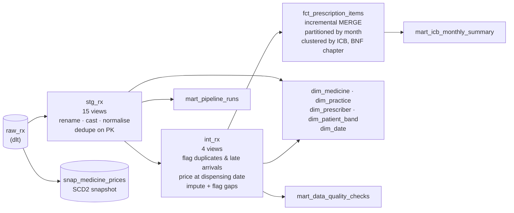

[← Back to README](../README.md)

# Phase 3: Transform (`dbt_rx/`)

dbt Core 1.12 with the BigQuery adapter turns `raw_rx` into a **star schema** for Power BI.



| Layer | BigQuery dataset | Materialisation |
|---|---|---|
| staging | `stg_rx` | views, 1:1 with sources |
| intermediate | `int_rx` | views |
| marts | `marts_rx` | tables (fact is incremental) |
| snapshots | `snapshots_rx` | dbt snapshot |

A `generate_schema_name` override writes to exactly these datasets in the `prod` target. Any
other target (CI) gets prefixed datasets, such as `ci_rx_marts_rx`, so CI never touches prod.

### Run it

```powershell
# one-time: copy dbt_rx\profiles.yml.example to %USERPROFILE%\.dbt\profiles.yml (it holds no secrets)
cd dbt_rx
dotenv -f ..\.env run -- dbt deps
dotenv -f ..\.env run -- dbt build              # models + snapshot + 169 tests, in DAG order
dotenv -f ..\.env run -- dbt source freshness
dotenv -f ..\.env run -- dbt docs generate      # then: dbt docs serve
# after changing business logic in the fact's upstream models:
dotenv -f ..\.env run -- dbt build --select fct_prescription_items+ --full-refresh
```

`dotenv run` loads the repo's `.env`, so dbt's `env_var()` sees the project ID and key path.

### Star schema

| Model | Grain | Notes |
|---|---|---|
| `fct_prescription_items` | dispensed line (2.5M) | Incremental `merge` on `item_line_id`. Partitioned by `dispensing_date` (month), clustered by `icb_code`, `bnf_chapter_code` |
| `dim_medicine` | presentation (570) | Full BNF hierarchy, generic/branded, generic equivalent |
| `dim_practice` | practice (400) | Region → ICB → practice, postcode for maps, deprivation quintile |
| `dim_prescriber` | prescriber (1,500) | Profession |
| `dim_patient_band` | age band × sex × deprivation (~240) | **No patient-level key in the marts** (privacy by design) |
| `dim_date` | day, 2022–2026 | NHS financial year (Apr–Mar), season |
| `mart_icb_monthly_summary` | ICB × month | Items per 1,000 patients, cost per item, generic prescribing rate, antibacterial rate, potential generic saving |
| `mart_data_quality_checks` | check (12) | Rows affected by each defect and how it is handled |
| `mart_pipeline_runs` | EL run × table | For the pipeline-health page |
| `snap_medicine_prices` | price version | SCD2 history captured by dbt from the current-price-only `medicine` table |

### Tests (169 data tests and checks in `dbt build`)

- **Generic tests:** `unique`, `not_null`, `relationships` (every fact foreign key to its
  dimension), `accepted_values`.
- **Package tests:** `dbt_utils` (`unique_combination_of_columns`, `expression_is_true`) and
  `dbt_expectations` (value ranges, regex on BNF codes, row counts).
- **Custom generic test:** `not_in_future` for watermark and date columns.
- **Singular tests:**
  - the incremental fact reconciles with a full recomputation (lines, items, cost);
  - the ICB summary adds back up to the fact;
  - the fact contains no double submissions;
  - price history is contiguous;
  - no line is dispensed before it is issued.
- **Source freshness:** source activity is checked on `prescription_item.updated_at`, and
  pipeline activity separately on `el_run_log.finished_at`.

### Verified end to end

`generator.simulate` → `el.run` → `dbt build`:
- the fact MERGEd only the ~5k changed lines;
- the snapshot closed 3 old price versions and opened 3 new ones;
- all 169 tests pass, including the reconciliation of the incremental fact against a full
  recomputation.

### What the tests caught (and the fixes)

1. **Incremental drift after a logic change.** After I changed an imputation rule, the
   reconciliation test failed: the incremental fact only reprocesses rows whose `updated_at`
   moves, so old rows kept the old logic. **Rule:** logic changes upstream of an incremental
   model need `--full-refresh`. The test makes forgetting that impossible to miss.
2. **An unstable duplicate key.** Double submissions were first detected on (prescription,
   medicine, date, items, quantity, cost). When a source correction changed the *original*
   line's quantity, its old duplicate stopped matching and would have counted as real in a
   full rebuild but not in the incremental fact. The key is now (prescription, medicine,
   dispensing date), which corrections cannot change. Dedup rules on mutable attributes and
   incremental models don't mix.
3. **A NULL boolean.** `is_credit` was NULL when both quantity and cost were missing, and
   Power BI would have silently treated it as neither true nor false. Every flag now has a
   `not_null` test.

A fourth issue came from analysis rather than tests. Items per 1,000 patients first came out at
**0.6 per month**, where real England figures are roughly 1,600. The generator simulates
prescribing for a 50,000-patient panel, while `list_size` is each practice's full registered
list (3.7M). Rates now use the panel (`registered_patients`), giving 1,270–1,840 items per
1,000 patients per month by region.

### Costs

| | Size / scan |
|---|---|
| Storage across all datasets | ~1.0 GB (raw 0.38 + marts 0.60). Free tier: 10 GB |
| Full `dbt build` | ~2 GB scanned |
| Incremental fact MERGE | ~0.6 GB (the target table is scanned because late arrivals and corrections can touch any month) |
| Guardrail | `maximum_bytes_billed: 5 GB` per query in the profile |

A daily run comes to roughly 60 GB of queries a month, against a 1 TB free tier.

### Design decisions

- **Staging stays dumb, intermediate holds the rules.** Staging only renames, casts,
  normalises codes and dedupes on the primary key. Double-submission detection, imputation and
  credit handling are in `int_*` with explicit flags, so every rule is visible and countable in
  the DQ mart.
- **Flag, don't silently fix.** Imputed costs carry `is_nic_imputed` /
  `is_actual_cost_imputed`. Duplicates are removed from the fact but counted.
- **Price at the dispensing date.** A range join to the price history gives the tariff price
  in force when each line was dispensed. The potential generic saving uses brand and generic
  prices from the same date.
- **Fact partitioning and clustering.** Partitioning by month matches the dashboard's time
  slicing, and clustering on ICB and BNF chapter matches its most common filters. The MERGE
  still scans the whole target, a known trade-off when corrections can touch any month.
- **Docs travel with the data.** `persist_docs` writes model and column descriptions into
  BigQuery, so Power BI shows them too.
- **Snapshot vs source history.** The source keeps its own `medicine_price_history`. The dbt
  snapshot shows how to build that SCD2 history when a source only stores the current value.
