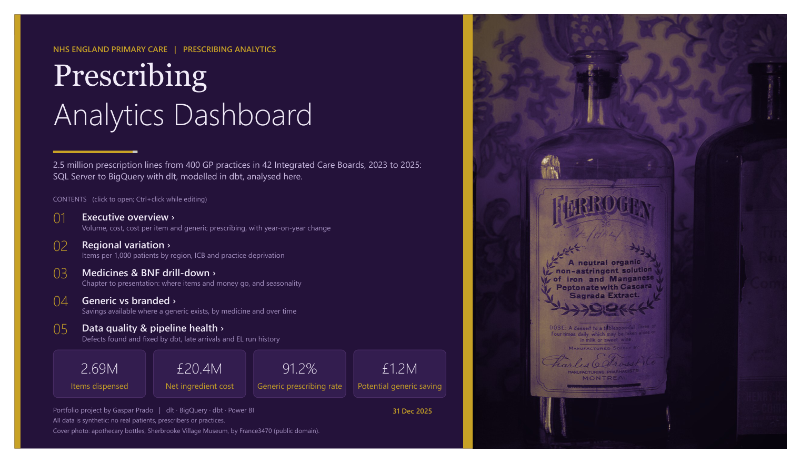
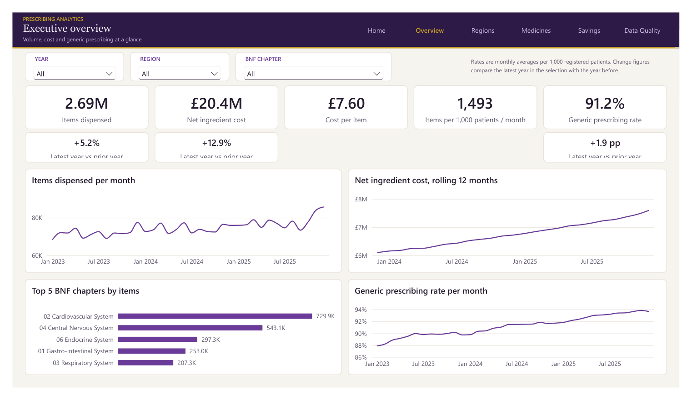
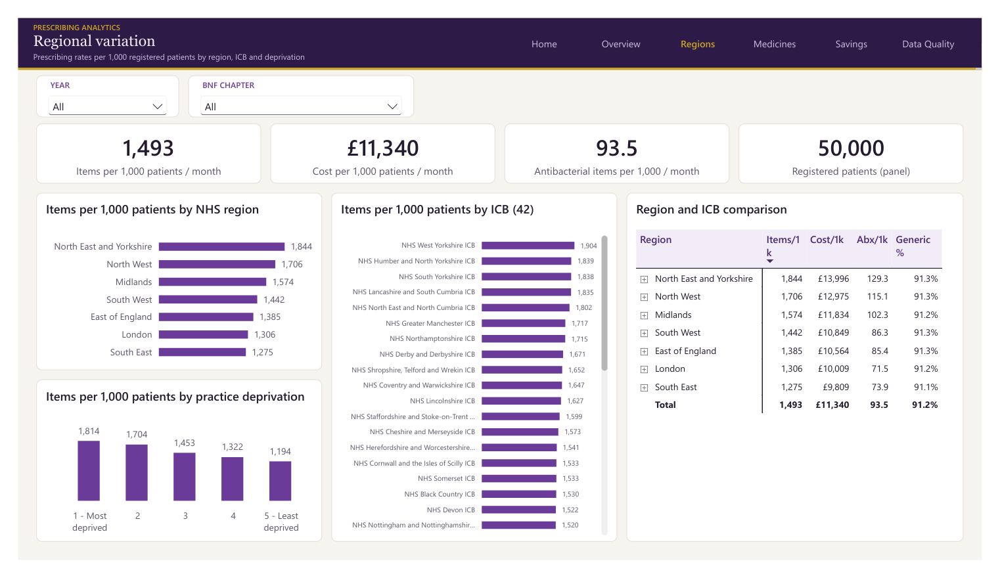
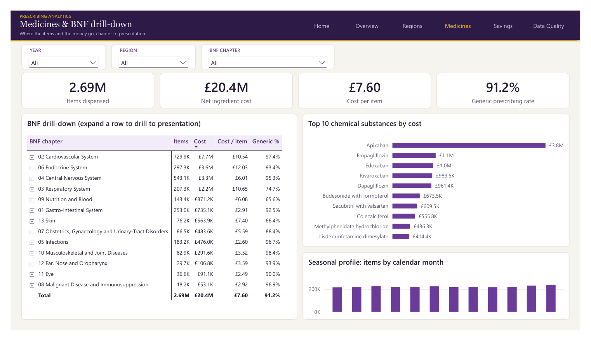
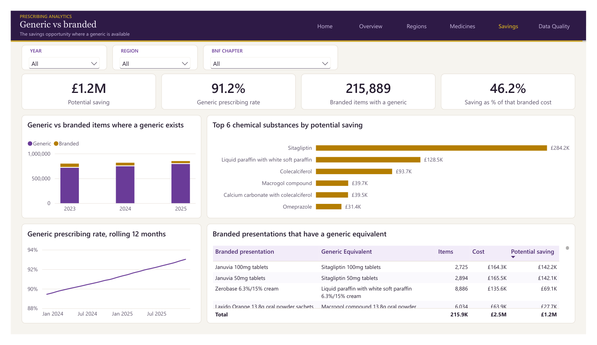
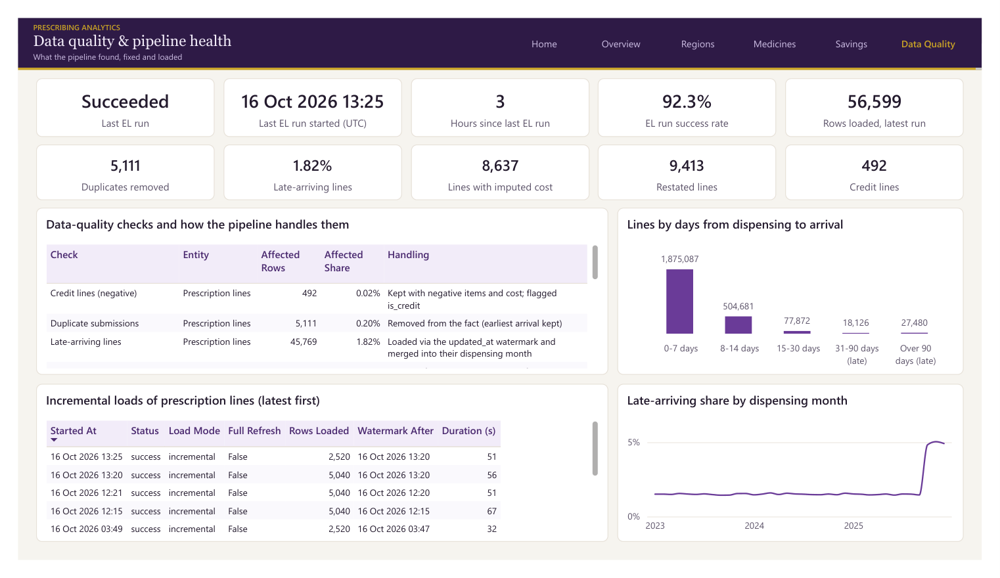
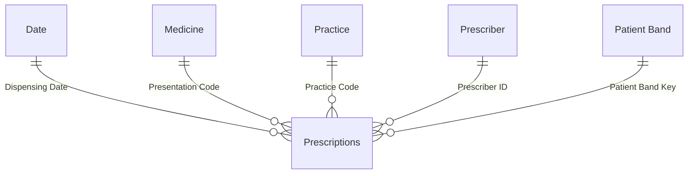

[← Back to README](../README.md)

# Phase 5: Power BI dashboard (`powerbi/`)

An import-mode Power BI report over the dbt marts, saved as **PBIP**: a TMDL semantic model plus a
PBIR report, both plain text, so every change is diffable in Git.

| Executive overview | Regional variation |
|---|---|
|  |  |
| **Medicines & BNF drill-down** | **Generic vs branded savings** |
|  |  |
| **Data quality & pipeline health** | |
|  | |

### Semantic model (`RxAnalytics.SemanticModel`)

Authored with the **Power BI modelling MCP server** (tables, relationships, hierarchies,
measures), exported to TMDL, then loaded and validated in Power BI Desktop.

- **Star schema:** single-direction one-to-many relationships, a marked Date table (2023–2025
  only, so "months in period" and time intelligence stay exact), and auto date/time switched off.
- **Two hierarchies:** BNF (chapter > section > paragraph > chemical > presentation) and
  Organisation (region > ICB > practice).
- **Two pipeline-health tables** with no relationships: Data Quality Checks and Pipeline Runs.
- **42 measures** in display folders, all with descriptions:

| Folder | Measures |
|---|---|
| Volume | Total Items, Prescription Lines, Total Quantity |
| Cost | Total Cost (net ingredient cost), Actual Cost, Cost per Item |
| Rates | Items per 1,000 Patients, Cost per 1,000 Patients, Antibacterial Items per 1,000 Patients (monthly averages) |
| Generic & Savings | Generic %, Generic/Branded Items Where Generic Available, Potential Generic Saving, Saving % of Branded Cost |
| Time Intelligence | Items / Cost YoY %, Generic % Change vs PY, Total Items / Cost PY, Items / Cost / Generic % Rolling 12M |
| Data Quality / Pipeline | Late Arrival %, Imputed Cost Lines, Duplicates Removed, Last EL Run, Hours Since Last EL Run, EL Success Rate |

**Validated against BigQuery:** lines, items, total cost (£20,412,879.81), generic rate, potential
saving, rates per 1,000, YoY and rolling 12-month values match direct SQL on the marts exactly.

### Report (`RxAnalytics.Report`, generated by `powerbi/_build/build_report.py`)

Six pages: a linked cover, then *Executive overview*, *Regional variation*, *Medicines & BNF
drill-down*, *Generic vs branded* and *Data quality & pipeline health*. Every page has the same
header navigation. The report is generated by code, which keeps layout, titles and formatting
consistent and lets a design change be one edit and a rebuild.

**Theme** ([`powerbi/theme/rx-plum-gold.json`](../powerbi/theme/rx-plum-gold.json)):
- **Data colours:** plum `#6A3B98`, gold `#B57D00`, lavender `#A07AD6` and bronze `#8A5A12` on a
  warm ivory canvas. They're used in fixed order, single-series charts are plum, and gold marks
  cost and savings.
- **Decoration:** a deep aubergine header with a thin gold rule, Georgia titles and Segoe UI text.
  These colours are never used for data.
- **Accessibility:** the data colours were **validated, not eyeballed**. A palette checker
  confirmed each sits in a readable lightness band and has enough chroma, adjacent colours stay
  distinguishable under simulated colour blindness (worst ΔE 24), and each reaches at least 3:1
  contrast on both the ivory canvas and white cards.

**Cover photo:** 1860s apothecary bottles, Sherbrooke Village Museum, by France3470, **public
domain** (Wikimedia Commons). It's graded to the plum and gold palette by
[`make_cover.py`](../powerbi/_build/make_cover.py).

### Open and refresh

1. Open `powerbi/RxAnalytics.pbip` in Power BI Desktop.
2. On the first refresh, choose **Google BigQuery → Service Account Login** and paste the
   read-only key's email and JSON. The `GCP Project` parameter sets the billing project.
3. Refresh. The 2.5M-row fact table loads in about 3–4 minutes.

To change the report layout, edit `build_report.py`, **close Desktop**, then run
`python powerbi/_build/build_report.py`. An open Desktop would overwrite the files on save.

### Design decisions and lessons

- **Read-only access:** a dedicated `rx-power-bi` service account with **BigQuery Data Viewer +
  Job User + Read Session User**. A test write was refused (403) before shipping.
- **Storage Read API off for the fact table:** Power BI's BigQuery driver failed to authenticate
  the Storage Read API with service-account login. The same key works from Python, and only
  large results use that API, so the fact query sets `UseStorageApi = false`; the small tables
  are unaffected.
- **Fix queries in the files, not in Desktop's model:** Power Query keeps its own copy of each
  query, so "Apply changes" overwrote a fix made only in the data model.
- **Year-on-year compares the latest year with the one before.** A `SAMEPERIODLASTYEAR` card
  across all years compared 2023–25 with 2023–24 and showed **+53%** instead of +5.2%.
- **Rates use the simulated patient panel** (50,000 patients), not practice list sizes (3.7M).
  Otherwise "items per 1,000 patients" would be 0.6 instead of a realistic ~1,500 a month.
- **Format strings:** visuals only scale K/M when the scaling commas sit before the decimal
  point (`£#,0,,.0"M"`). `£#,0.0,,"M"` renders a stray comma.
- **`lag` is not a valid DAX variable name.** One failing calculated column fails the whole
  refresh.
- **No map visual:** maps are disabled by default in Desktop's security settings, so an
  ICB bar chart replaces it.
